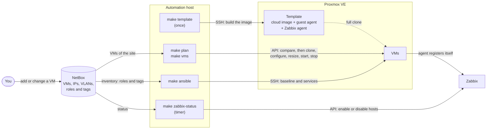
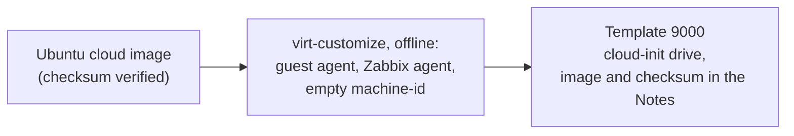
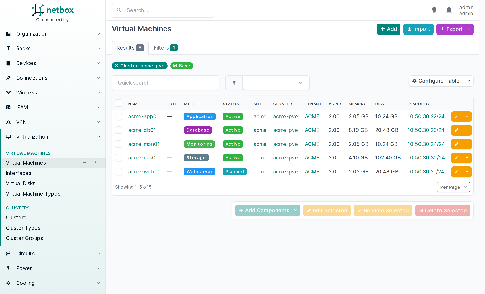
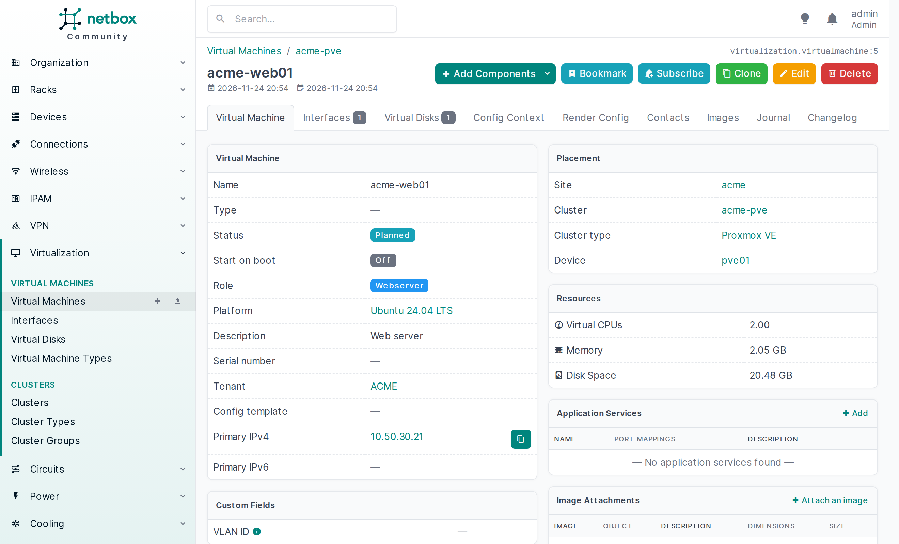
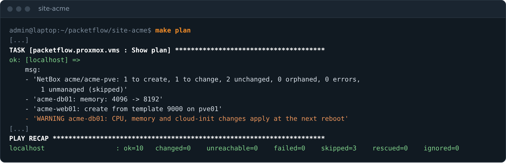
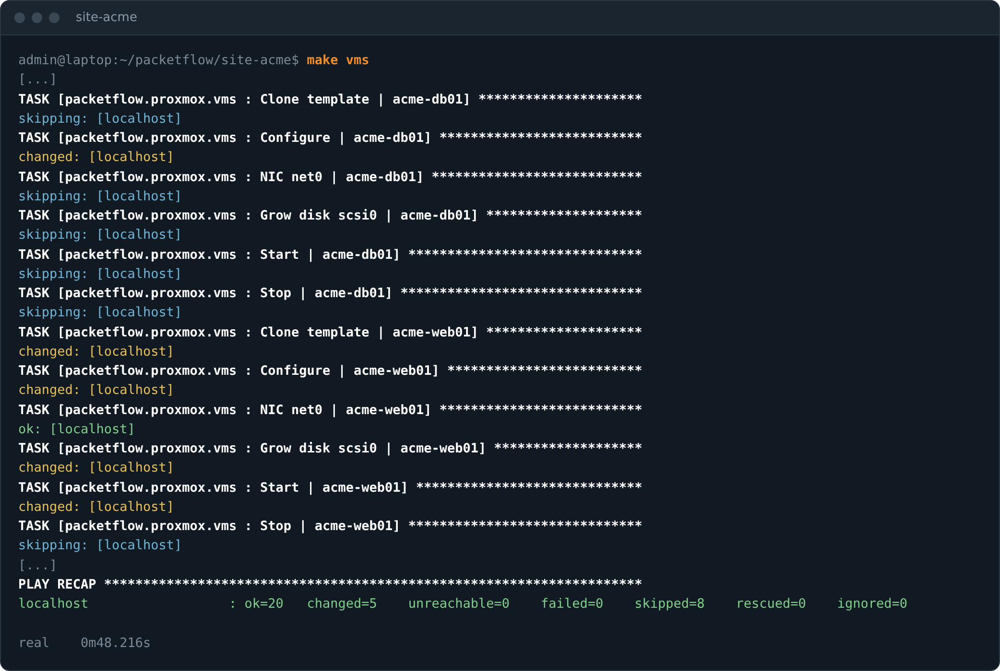
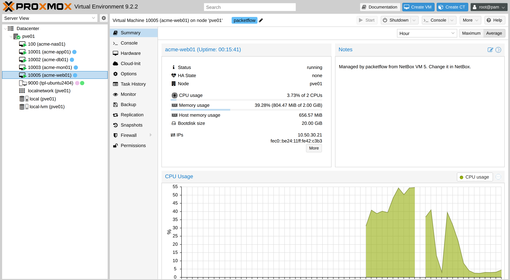
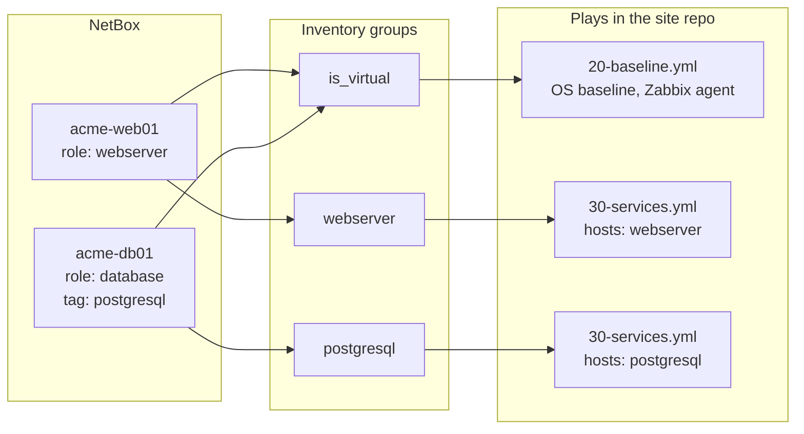

# proxmox-netbox-ansible

**Describe a VM in NetBox, and Ansible builds it on Proxmox VE.** You add the
VM in NetBox (name, cluster, vCPUs, memory, disk, VLAN, IP, platform), run
`make plan` to see what would change, and `make vms` to clone, configure,
resize, start or stop it. `make ansible` then configures it: the VM's **role
and tags in NetBox decide which services it gets**. Monitoring follows along:
the Zabbix agent is in the template, and a VM you set to offline in NetBox
stops alerting.

Nobody clicks a VM together in the Proxmox UI, and NetBox can't drift from
what runs, because it is what the VMs are built from.

> **Public snapshot.** A trimmed copy of the automation
> [Packetflow](https://packetflow.be) uses (November 2026), published to show
> how the pieces fit together. It is not kept in sync, so read it as a worked
> example to take ideas and code from. Names and addresses are examples
> (`acme` is a fictional site); the screenshots are real runs of this code
> on a lab node. Apache-2.0.

## How it works



NetBox is only ever read. The automation host holds a **site repo**: a small
Git repo with the site's settings and encrypted secrets, generated from the
template in this repo. The code (the Ansible collections here) is pinned in it
at a tag.

| Step | Command | What happens |
|---|---|---|
| Once | `make template` | builds the VM template on the Proxmox node from Ubuntu's cloud image |
| 1 | (in NetBox) | you add or change the VM |
| 2 | `make plan` | compares NetBox with Proxmox and prints the difference; changes nothing |
| 3 | `make vms` | applies the plan through the Proxmox API |
| 4 | `make ansible` | configures the VMs over SSH, by NetBox role and tag |
| On a timer | `make zabbix-status` | disables or enables Zabbix hosts to match the NetBox status |

### Once: the template

`make template` builds the template every VM is cloned from. It downloads the
distro's official cloud image, checks it against the vendor's checksum, and
customizes it offline on the node with `virt-customize`: the QEMU guest agent
and the Zabbix agent go in, the machine-id comes out. No installer runs and
no VM boots during the build, so it takes a few minutes and can be repeated
whenever the vendor publishes a new image.



Ubuntu 24.04 and 26.04 are the site templates; Ubuntu 22.04 and Debian 12/13
build as test templates. Details and other distros:
[docs/templates.md](docs/templates.md) and
[`roles/template`](ansible_collections/packetflow/proxmox/roles/template/README.md).

### 1. Describe the VM in NetBox



Everything the VM needs is a normal NetBox field. `acme-web01` is *Planned*,
so the next run creates it:



| Proxmox | From NetBox |
|---|---|
| exists and running / stopped | status `active`, `planned` or `staged` / `offline` |
| VM ID | 10000 + NetBox VM ID |
| node | the VM's device (the Proxmox node), else the site's default node |
| template | the VM's platform, looked up in `vms_templates` (`ubuntu-2604` → template 9001), else the default template |
| cores, memory, disk | vCPUs, memory, virtual disks (disks only grow) |
| network | the untagged VLAN of the VM's interface: that tag on the bridge, or a Proxmox SDN VNet |
| IP, gateway, DNS | primary IPv4 through cloud-init, or DHCP with the tag `dhcp` |

The full mapping is in
[`roles/vms`](ansible_collections/packetflow/proxmox/roles/vms/README.md).

### 2. `make plan`: see what would change



The plan compares the site's VMs in NetBox with what the Proxmox API reports
and changes nothing. Here: `acme-web01` to create, a memory change on
`acme-db01` (stored now, applied at the VM's next reboot, so it warns), two
VMs already right, and one hand-built VM that NetBox only documents (tag
`unmanaged`).

The role is careful on purpose:

- **Nothing is deleted.** A VM that is in Proxmox but no longer wanted in
  NetBox is reported as an *orphan*. You remove it by hand.
- **It only touches its own VMs:** the ones it created, which carry the tag
  `packetflow` in Proxmox. On a shared cluster each site gets its own pool.
- **Any plan error stops the run before the first change:** a missing IP, a
  gateway outside the subnet, a disk that would shrink, an unknown platform.
- **Nothing is rebooted.** CPU, memory and cloud-init changes on a running VM
  wait for its next reboot.

### 3. `make vms`: build it

`make vms` runs the same plan and applies it. The run below took 48 seconds
on a small lab node:



The result in Proxmox: VM 10005 is NetBox VM 5, it carries the tag
`packetflow`, and its Notes say where to change it.



Step by step:

```mermaid
sequenceDiagram
  actor You
  participant NB as NetBox
  participant CTL as Automation host
  participant PVE as Proxmox API
  participant VM as acme-web01
  participant ZBX as Zabbix

  You->>NB: add acme-web01 (cluster, node, platform, size, VLAN, IP)
  You->>CTL: make vms
  CTL->>NB: read the site's VMs, interfaces and VLANs
  CTL->>PVE: read the VMs and their configuration
  CTL->>CTL: plan. Any error stops the run here
  CTL->>PVE: full clone of the template as VM 10000 + NetBox ID
  CTL->>PVE: cores, memory, tag, cloud-init (user, SSH keys, IP, DNS)
  CTL->>PVE: network card on the VLAN, grow the disk
  CTL->>PVE: start
  VM->>ZBX: first boot, the agent registers itself
  You->>CTL: make ansible
  CTL->>NB: inventory (roles and tags become groups)
  CTL->>VM: baseline, then the services its role and tags ask for
```



The API user that does this has four ACLs and nothing else; the `pveum`
commands are in the
[`vms` README](ansible_collections/packetflow/proxmox/roles/vms/README.md#least-privilege-api-user-ansiblepve).

### 4. `make ansible`: roles and tags decide the services

`make ansible` takes its inventory from NetBox too. The inventory groups
hosts by NetBox **role** and **tag**, and every play in the site repo targets
one of those groups:



```yaml
# playbooks/30-services.yml in a site repo
- name: Webservers
  hosts: webserver          # every VM with the NetBox role `webserver`
  become: true
  roles:
    - your_namespace.your_collection.nginx
```

Giving a VM a service is a role or a tag in NetBox and `make ansible`. A new
kind of service is one play. This repo brings the mechanism and the Zabbix
agent; the service roles are yours (or Galaxy's).

### 5. Monitoring follows NetBox

The Zabbix agent is in the template with the site's PSK, so a new VM
registers itself at first boot, before any playbook has run.

After that, `make zabbix-status` keeps Zabbix in line with NetBox. A VM set
to `offline` or `decommissioning` is disabled in Zabbix and stops alerting.
Set back to `active`, it is enabled again. Hosts someone disabled by hand are
left alone. Run it on a schedule, for example a systemd user timer on the
automation host:

```ini
# ~/.config/systemd/user/zabbix-status.timer
[Timer]
OnBootSec=5min
OnUnitActiveSec=15min
Persistent=true
```

Details: [`roles/host_status`](ansible_collections/packetflow/zabbix/roles/host_status/README.md)
and [`roles/agent`](ansible_collections/packetflow/zabbix/roles/agent/README.md).

## Getting started

You need a Proxmox VE node (8 or 9), a NetBox (4.x) and, for the monitoring
part, a Zabbix server (7.x). **[docs/setup.md](docs/setup.md)** goes from a
fresh machine to the first VM, in order. In short:

```bash
# once, on your machine
gh repo clone Packetflow-be/proxmox-netbox-ansible ~/packetflow/proxmox-netbox-ansible
cd ~/packetflow/proxmox-netbox-ansible
make setup              # ansible, copier, sops in a venv
make site NAME=lab      # new site repo at ~/packetflow/site-lab; Copier asks the questions

# per site
cd ~/packetflow/site-lab
make secrets            # Proxmox, NetBox and Zabbix tokens, encrypted with sops/age
make deps               # the collections of this repo, at the pinned tag
make seed APPLY=1       # NetBox: tenant, cluster, node, roles
make template           # the VM template on the node
make plan && make vms   # after adding a VM in NetBox
make ansible
```

## What's in here

| Path | What |
|---|---|
| [`ansible_collections/packetflow/proxmox`](ansible_collections/packetflow/proxmox/README.md) | roles `template` (cloud image → Proxmox template) and `vms` (NetBox → Proxmox: plan, then apply), and the `vm_plan` filter that holds the plan logic |
| [`ansible_collections/packetflow/zabbix`](ansible_collections/packetflow/zabbix/README.md) | roles `agent` (baked into the template, kept in line afterwards) and `host_status` (NetBox status → Zabbix) |
| [`site-template/`](docs/site-template.md), `copier.yml` | the Copier template for a site repo: inventory from NetBox, playbooks, Makefile, sops secrets, CI |
| `scripts/` | `netbox-seed.py` (the NetBox objects the automation expects), `bootstrap-wsl.sh` (`make setup`), `release.sh` ([scripts/README.md](scripts/README.md)) |
| `docs/` | [`setup.md`](docs/setup.md): fresh machine → first VM; [`operations.md`](docs/operations.md): day to day in NetBox; [`templates.md`](docs/templates.md): templates and other distros; [`site-template.md`](docs/site-template.md): the site repo and its questions; [`roles.md`](docs/roles.md): defaults and the reasoning behind them |

## Tests and CI

The roles are tested without a Proxmox node: the `vms` role runs against fake
Proxmox and NetBox APIs with the real `community.proxmox` and `netbox.netbox`
modules, the `template` role against a fake `qm` and `virt-customize`, and the
plan logic has unit tests. `make check` runs everything CI runs.

| Workflow | Does |
|---|---|
| `ansible.yml` | per changed collection: `yamllint --strict`, `ansible-lint` (profile `production`), `pytest tests/unit`, `tests/integration/*/run.sh`, `ansible-galaxy collection build` |
| `scripts.yml` | shellcheck, ruff, pytest for `scripts/` |
| `site-template.yml` | renders the site template with test answers, then yamllint, actionlint and a dry run of every make target on the result |

## About

Built by [Packetflow](https://packetflow.be) (industrial networks and OT
infrastructure, Belgium). Questions or ideas: open an issue.
