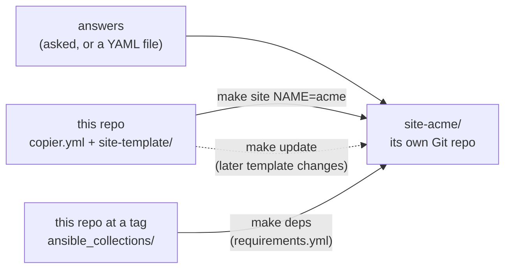

# The site repo

The collections in this repo hold the code. A **site repo** holds one site's
data: which NetBox tenant and Proxmox cluster, the network defaults, and the
encrypted secrets. It is generated with [Copier](https://copier.readthedocs.io/)
from [`site-template/`](../site-template) (questions in [`copier.yml`](../copier.yml))
and pins this repo at a tag.

A site is one NetBox tenant with one Proxmox cluster (more clusters can be
added later): a location, a department, or everything you have.



## What you get

```text
site-acme/
├── inventory/netbox.yml          # Ansible inventory = NetBox (the tenant's devices and VMs)
├── inventory/group_vars/all/     # the answers below + encrypted secrets (sops/age)
├── playbooks/                    # 00-template, 05-vms, 20-baseline, 30-services, 50-zabbix-status
├── requirements.yml              # this repo's collections at a tag
├── .github/workflows/            # ansible-lint; optional `make plan` on pull requests
└── Makefile                      # everything below; secrets are injected with sops exec-env
```

```text
make secrets         create and encrypt the secrets, open the editor
make deps            install the Ansible collections into ./.collections
make seed            NetBox objects for this site (dry run; APPLY=1 writes)
make template        build the VM template on the node (FORCE=1 rebuilds it)
make plan            what `make vms` would change in Proxmox (changes nothing)
make vms             make the Proxmox VMs match NetBox
make check           configuration, dry run (--check --diff)
make ansible         configuration: OS baseline, Zabbix agent, services per NetBox role and tag
make site            vms + ansible
make zabbix-status   Zabbix hosts disabled when NetBox says offline or decommissioning
make update          pull template changes, keeping your answers
make publish         optional: push to a private GitHub repo
```

Credentials never touch the disk in plain text: every target runs as
`sops exec-env secrets.sops.yaml '<command>'`, so the tokens exist only in
that command's environment. What the generated repo contains, target by
target, is in its own README ([`site-template/README.md.jinja`](../site-template/README.md.jinja)).

## Create one

From a checkout of this repo (does the `git init` and first commit too):

```bash
make site NAME=acme                                        # asks the questions below
make site NAME=acme ANSWERS=~/packetflow/answers/acme.yml  # no questions: answers from the file
```

An answers file is plain YAML with one key per question (example:
[`tests/site-template/answers.yml`](../tests/site-template/answers.yml));
nothing in it is secret. Keep it: recreating the site, or making a similar
one, is then one command. After creation the answers also live in the site
repo's `.copier-answers.yml`; change one later with
`make update DATA=key=value` in the site repo.

Or with Copier directly:

```bash
copier copy gh:Packetflow-be/proxmox-netbox-ansible site-acme
cd site-acme && git init -b main && git add -A && git commit -m "site-acme from site-template"
```

Copier uses the latest tag of this repo, or HEAD when there are none;
`--vcs-ref <tag>` pins one. Then, in the site repo: `make secrets`,
`make deps`, `make seed`, `make template`, `make plan`, `make vms`.
Walkthrough: [setup.md](setup.md).

## Questions

| Question | Default | Used for |
|---|---|---|
| `site_slug` | | repo name, Proxmox token ID. `[a-z0-9_]` only |
| `site_name` | from the slug | READMEs |
| `netbox_url` | `https://netbox.internal.example.com` | inventory, `NETBOX_URL` |
| `netbox_validate_certs` | `true` | `false` for a self-signed NetBox certificate |
| `netbox_tenant_slug` | the slug | NetBox filter (VMs and inventory) |
| `netbox_cluster` | `<tenant>-pve` | NetBox filter (VMs); `make seed` creates `<tenant>-pve` |
| `pve_host` | | `PROXMOX_HOST`: node name or IP, no scheme or port |
| `pve_validate_certs` | `true` | `false` for Proxmox's self-signed certificate |
| `pve_template_vm_id` | `9000` | the template to build and clone |
| `pve_datastore` | `local-lvm` | template, VM disks, cloud-init drives |
| `default_node` | | node for VMs without a NetBox device; the template is built here |
| `vm_bridge` | `vmbr0` | VM network cards |
| `default_vlan` | `null` | VLAN when a VM's interface has none |
| `default_gateway` | | gateway when `vms_vlan_gateways` has no entry for the VLAN |
| `dns_servers` | **required** | cloud-init. The site's DNS: it must resolve `zabbix-proxy` |
| `dns_domain` | **required** | cloud-init search domain; `zabbix-proxy.<domain>` |
| `ssh_public_keys` | | cloud-init user `ansible` (at least one key) |
| `age_recipients` | | `.sops.yaml` (comma-separated `age1…` public keys) |
| `collections_ref` | `v0.5.11` | the tag of this repo to install the collections from |

`ssh_public_keys` is a question because a VM without a key is unreachable.
`dns_servers` and `dns_domain` have no defaults: VMs find Zabbix through the
site's DNS, which public resolvers can't do.

## Working on the template

`site-template/` is copied; `*.jinja` files are rendered. Render the checkout
you're in with the test answers:

```bash
copier copy --defaults --data-file tests/site-template/answers.yml --vcs-ref HEAD . /tmp/site-test
```

CI (`.github/workflows/site-template.yml`) does the same and runs
`yamllint --strict` with the generated `.yamllint`, actionlint on the
generated workflows, and a `make -n` dry run of every target.
